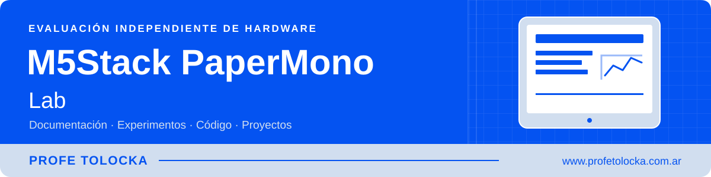

  
  <h1>M5Stack PaperMono Lab</h1>
  
<a href="README.md">English</a> · <strong>Español</strong>

---

## Presentación

Evaluación independiente y práctica del M5Stack PaperMono realizada por Ernesto Tolocka (ProfeTolocka). Este repositorio reúne artículos técnicos bilingües, experimentos reproducibles y proyectos prácticos. La documentación está disponible en español e inglés, mientras que el código y los recursos son compartidos.

**Estado del proyecto:** Evaluación en curso.

## Guía del repositorio

| Sección | Descripción |
| :--- | :--- |
| [Artículos y documentación](docs/README.es.md) | Guías técnicas y notas de evaluación. |
| [Ejemplos de código](examples/README.es.md) | Experimentos de programación sencillos y reproducibles. |
| [Proyectos](projects/README.es.md) | Aplicaciones completas y código compartido. |
| [Hardware](hardware/README.es.md) | Interfaces y diagramas. |
| [Mediciones](benchmarks/README.es.md) | Rendimiento de pantalla y consumo. |
| [Firmware](firmware/README.es.md) | Entornos de desarrollo y pruebas de compatibilidad. |
| [Plantillas editoriales](templates/README.es.md) | Plantillas bilingües reutilizables. |

## Artículos

Todas las entradas son esquemas previstos, no evaluaciones terminadas.

| Sección | Descripción |
| :--- | :--- |
| [Conociendo el PaperMono](docs/01-introduction/README.es.md) | Primeras impresiones y aplicaciones previstas. |
| [Hardware y arquitectura](docs/02-hardware/README.es.md) | Arquitectura, interfaces y periféricos. |
| [Primeros pasos con la programación](docs/03-programming/README.es.md) | Entornos de desarrollo y primeras pruebas. |
| [Explorando la pantalla e-paper](docs/04-display/README.es.md) | Renderizado y modos de refresco. |
| [Conectividad Wi-Fi y Bluetooth](docs/05-connectivity/README.es.md) | Interfaces inalámbricas y experimentos. |
| [Consumo energético y autonomía](docs/06-power/README.es.md) | Métodos de medición y pruebas de autonomía. |
| [Firmwares alternativos y compatibilidad](docs/07-firmware/README.es.md) | Pruebas de compatibilidad, incluida la posibilidad de soporte de Meshtastic. |
| [Aplicaciones prácticas](docs/08-applications/README.es.md) | Ideas y enlaces a proyectos documentados. |

## Proyectos y ejemplos

Consultá los índices de [proyectos](projects/README.es.md) y [ejemplos](examples/README.es.md). Cada entrada contiene dos versiones idiomáticas y una sola base de código. La estación meteorológica y Hello World son entradas ilustrativas pendientes.

## Acerca de

Creado por **Ernesto Tolocka — ProfeTolocka**. Proyecto independiente; no es documentación oficial de M5Stack. Las licencias quedan pendientes de confirmación.

[ProfeTolocka](https://www.profetolocka.com.ar/) · [GitHub](https://github.com/profetolocka) · [Hackster.io](https://www.hackster.io/etolocka)

---

<strong>PROFE TOLOCKA</strong> · <a href="https://www.profetolocka.com.ar/">www.profetolocka.com.ar</a>

## Organización de las imágenes

Las infografías, capturas con texto y diagramas traducidos se guardan en [assets/es/](assets/es/). Sus equivalentes en inglés están en [assets/en/](assets/en/). Las fotografías, esquemas sin texto y recursos independientes del idioma van en [assets/shared/](assets/shared/). Usá el mismo nombre de archivo para ambas versiones traducidas.
