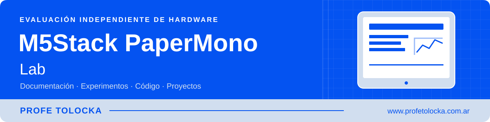

  
  <h1>Plantillas editoriales</h1>
  
<a href="README.md">English</a> · <strong>Español</strong>

[← Inicio](../README.es.md)

---

Plantillas bilingües reutilizables.

| Sección | Descripción |
| :--- | :--- |
| [Plantilla de artículo](article/README.es.md) | Esquema reutilizable de artículo técnico. |
| [Plantilla de proyecto](project/README.es.md) | Esquema reutilizable de documentación de proyecto. |

> **Estado:** Previsto — todavía no se han publicado resultados ni código.

---

<strong>PROFE TOLOCKA</strong> · <a href="https://www.profetolocka.com.ar/">www.profetolocka.com.ar</a>

