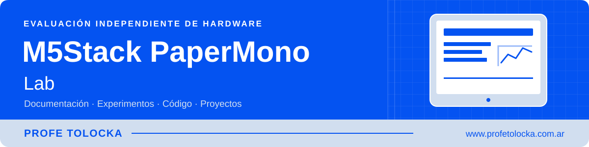

  
  <h1>Título del artículo</h1>
  
<a href="README.md">English</a> · <strong>Español</strong>

[← Inicio](../../README.es.md) · [Índice de la sección](../README.es.md)

---

> Plantilla editorial. Reemplazá las indicaciones ocultas por tu contenido.

## Introducción

<!-- Describir el problema y la aplicación propuesta. -->

## Objetivos

<!-- Indicar qué debe hacer el proyecto. -->

## Fundamentos técnicos

<!-- Explicar los conceptos involucrados. -->

## Método y montaje

<!-- Describir versiones, condiciones y procedimiento. -->

## Resultados y análisis

<!-- Distinguir observaciones de hipótesis. -->

## Conclusiones

<!-- Resumir resultados y limitaciones. -->

## Referencias y artículos relacionados

<!-- Agregar fuentes verificadas y enlaces a artículos relacionados del blog. -->

[Imágenes compartidas](assets/)

---

<strong>PROFE TOLOCKA</strong> · <a href="https://www.profetolocka.com.ar/">www.profetolocka.com.ar</a>

## Organización de las imágenes

Las infografías, capturas con texto y diagramas traducidos se guardan en [assets/es/](assets/es/). Sus equivalentes en inglés están en [assets/en/](assets/en/). Las fotografías, esquemas sin texto y recursos independientes del idioma van en [assets/shared/](assets/shared/). Usá el mismo nombre de archivo para ambas versiones traducidas.
