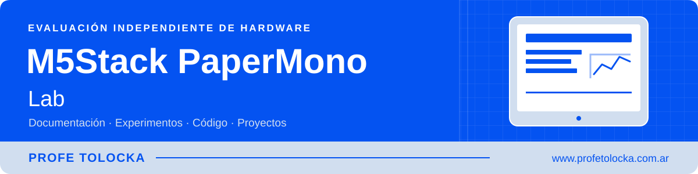

  
  <h1>Título del proyecto</h1>
  
<a href="README.md">English</a> · <strong>Español</strong>

[← Inicio](../../README.es.md) · [Índice de la sección](../README.es.md)

---

> Plantilla editorial. Reemplazá las indicaciones ocultas por tu contenido.

[Código fuente](src/) · [Imágenes](assets/) · [Hardware](hardware/) · [Datos de prueba](data/)

## Introducción

<!-- Describir el problema y la aplicación propuesta. -->

## Objetivos

<!-- Indicar qué debe hacer el proyecto. -->

## Materiales necesarios

<!-- Enumerar componentes y herramientas. -->

## Principio de funcionamiento

<!-- Explicar arquitectura y flujo de datos. -->

## Conexiones eléctricas

<!-- Documentar pines, alimentación y diagramas. -->

## Desarrollo del software

<!-- Explicar módulos, dependencias y código. -->

## Instalación y configuración

<!-- Proporcionar instrucciones reproducibles y versiones probadas. -->

## Pruebas y resultados

<!-- Registrar comportamiento esperado y observado. -->

## Conclusiones

<!-- Resumir resultados y limitaciones. -->

## Referencias

<!-- Agregar fuentes verificadas y enlaces relacionados del blog. -->

---

<strong>PROFE TOLOCKA</strong> · <a href="https://www.profetolocka.com.ar/">www.profetolocka.com.ar</a>

## Organización de las imágenes

Las infografías, capturas con texto y diagramas traducidos se guardan en [assets/es/](assets/es/). Sus equivalentes en inglés están en [assets/en/](assets/en/). Las fotografías, esquemas sin texto y recursos independientes del idioma van en [assets/shared/](assets/shared/). Usá el mismo nombre de archivo para ambas versiones traducidas.
